<div align="center">



<a href="https://github.com/Abenavidese">
  
</a>

<p>
  
  
  
  
</p>

</div>

---

## 🧭 About me

```python
class Anthony:
    location   = "Cuenca, Ecuador 🇪🇨"
    degree     = "BEng Computer Science @ Universidad Politécnica Salesiana (2026)"
    focus      = ["LLM systems", "RAG & agents", "Computer vision", "Backend / microservices"]
    shipped    = {
        "dental_ai":  "Tooth segmentation + ICDAS classifier used by real dentists",
        "pandora":    "Multi-tenant ERP in production for 5 companies",
        "aether":     "Multi-tenant RAG + agent swarm with eval-driven development",
    }
    community  = "ETH Ecuador core team 🌐"
    learning   = "AWS Machine Learning Engineer Associate"
    fun_fact   = "full stack dev & ceviche lover 🍤"

    def motto(self):
        return "Measure it, test it, ship it."
```

<div align="center">
  
</div>

---

## 🚀 Featured work

<table>
<tr>
<td width="50%" valign="top">

### 🤖 [Aether-ITSM](https://github.com/Abenavidese/Aether-ITSM)
**Multi-tenant AI service desk** · Nebius × NVIDIA hackathon

LangGraph agent swarm + hybrid RAG (pgvector HNSW + BM25 + exact IDs + multilingual reranker), Postgres row-level security, vision on screenshots, cost and p50/p95 latency tracing, red-team script and CI.

`Python` `LangGraph` `pgvector` `FastAPI` `Ollama` `GitHub Actions`

</td>
<td width="50%" valign="top">

### 🦷 ICDAS Dental AI · *CEDIA / UPS research*
**Computer vision in clinical use**

Trained the tooth **segmentation model** that feeds a cascade and the **ICDAS caries classifier**. Gathered requirements and defined the labeling directly with dentists, then iterated on post-launch feedback.

`PyTorch` `Segmentation` `Classification` `LoRA` · *private*

</td>
</tr>
<tr>
<td width="50%" valign="top">

### 🧾 Pandora ERP · *F.S.O. Group*
**From zero to production in ~6 months**

Top backend contributor of a ~20-microservice ERP: electronic invoicing (SRI), accounting, treasury, payroll, withholdings and purchasing. Live for 5 companies, with Jest test suites.

`NestJS` `PostgreSQL` `Redis` `Supabase` `Render` · *private*

</td>
<td width="50%" valign="top">

### 🛡️ [EqualPass Identity](https://github.com/Abenavidese/EqualPass-Identity) & [Rayls Shield](https://github.com/Abenavidese/rayls-shield-BA)
**Privacy-first Web3 hackathon builds**

Fraud-proof student verification for LATAM with zero-knowledge proofs, biometric device checks and soulbound NFTs on Polkadot.

`TypeScript` `Solidity` `ZK proofs` `Polkadot`

🏆 Aleph hackathon winner · 🥈 Rayls hackathon 2nd place

</td>
</tr>
<tr>
<td width="50%" valign="top">

### 📚 [Library Management System](https://github.com/Abenavidese/ProyectoIntegradorAB)
**Full-stack university integrator project**

Angular 17 frontend (loans, reservations, returns, reports) with a JWT interceptor, plus a [Jakarta EE backend](https://github.com/Abenavidese/ProyectoJakarataEE) (JAX-RS, JPA, EJB, WildFly, roles).

`Angular` `Java` `Jakarta EE` `JWT`

</td>
<td width="50%" valign="top">

### ⚡ [CUDA & Vision Labs](https://github.com/Abenavidese/CUDA-Parallel-Computing)
**GPU computing and classic CV**

CPU vs GPU [filter benchmarks](https://github.com/Abenavidese/filter-performance-cpu-gpu), [super-resolution + object detection benchmark](https://github.com/Abenavidese/cv-superres-objectdetection-benchmark) and [CUDA image labs](https://github.com/Abenavidese/cuda-image-labs).

`C++` `CUDA` `OpenCV` `MPI`

</td>
</tr>
</table>

<details>
<summary><b>📊 Aether-ITSM eval results (click to expand)</b></summary>
<br/>

Retrieval quality over a 74-query evaluation set, baseline → final system:

| Metric | Baseline | Final |
|:--|:--:|:--:|
| hit@1 | 0.625 | **0.938** |
| hit@5 | 0.781 | **0.984** |
| MRR | 0.689 | **0.961** |
| nDCG@5 | 0.709 | **0.957** |
| Correct "no answer" | 0.20 | **0.80** |
| Cross-tenant leaks | — | **0** |

Agent safety: 42 ticket scenarios + 10 concierge cases, **0 unsafe actions** · **287 tests** passing.

</details>

---

## 🛠️ Tech stack

<div align="center">

**🧠 AI / ML**<br/>

<br/>


**⚙️ Backend & Data**<br/>


**🎨 Frontend**<br/>


**☁️ DevOps & Web3**<br/>


</div>

---

## 📈 GitHub activity

<div align="center">


<picture>
  <source media="(prefers-color-scheme: dark)" srcset="https://raw.githubusercontent.com/Abenavidese/Abenavidese/output/github-snake-dark.svg"/>
  <source media="(prefers-color-scheme: light)" srcset="https://raw.githubusercontent.com/Abenavidese/Abenavidese/output/github-snake.svg"/>
  
</picture>

</div>

---

<div align="center">

### 🤝 Let's build something awesome together

Open to **AI Engineer**, **LLM Engineer** and **Full-Stack** roles, remote from LATAM.<br/>
Happy to talk about RAG evaluation, agents, computer vision or Web3. 🌎


</div>
